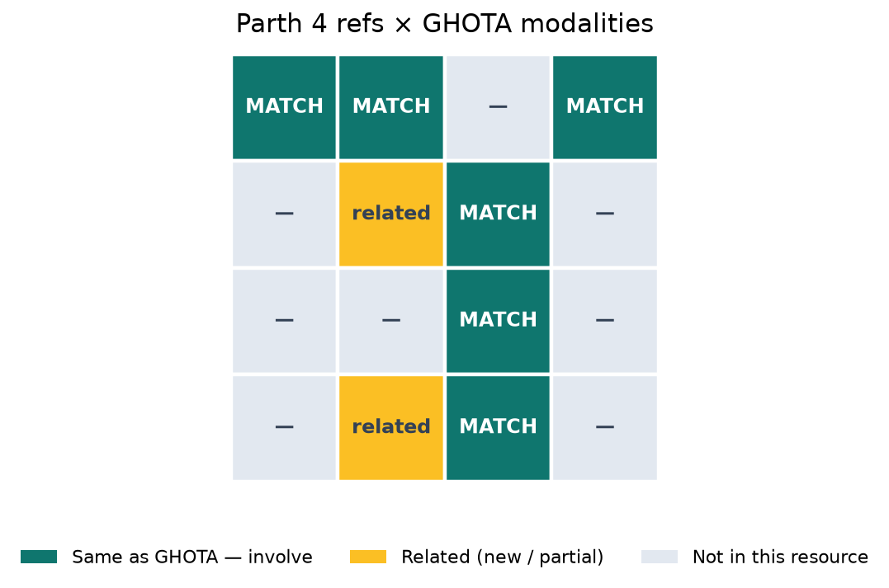
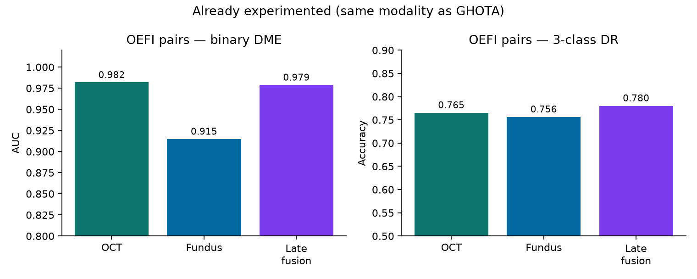

# Mentor brief — 4 reference resources vs GHOTA modalities

**Question:** Do Parth’s 4 links share modalities with our GHOTA setup, and can we experiment / involve them?

**GHOTA today (what we train/serve):**
- **Colour fundus** → DR severity (3-class)
- **Structural OCT B-scan** → DME / DR severity (3-class)
- **Late fusion** when same-eye fundus+OCT exist

---

## One-screen answer

| # | Resource | Modalities in the resource | Same as GHOTA? | Can we involve now? | What we did / next |
|---|----------|----------------------------|----------------|---------------------|--------------------|
| **1** | [OEFI — OCT + Eye Fundus](https://github.com/Traslational-Visual-Health-Laboratory/OCT-AND-EYE-FUNDUS-DATASET) | Colour **fundus** + structural **OCT** (paired by patient/eye) | **Yes — exact match** | **Yes — already involved** | Downloaded full set · **409 pairs** · OCT/fundus/late-fusion eval |
| **2** | [OCTA-500](https://ieee-dataport.org/open-access/octa-500) | **OCT volumes** + **OCTA** + projections + disease/seg labels | **Partial** (OCT yes; OCTA = new modality) | **Not yet** — IEEE login + password email | Ready to add as OCTA / volume branch after access |
| **3** | [ROAD](https://mip2019.github.io/ROAD/) | **WF-OCTA** en-face · no DR / mild NPDR / PDR | **Partial** (DR labels yes; imaging = OCTA not CFP/OCT B-scan) | **Not yet** — email authors | Maps cleanly to GHOTA 0/1/2 once downloaded |
| **4** | [DcardNet arXiv 2006.05480](https://arxiv.org/abs/2006.05480) | En-face **OCT + OCTA** (private OHSU cohort) | **Partial** (idea match; data locked) | **Cite / benchmark only** — no public dump | Use as related-work & multi-level DR design reference |

---

## Modality map (visual)



```
GHOTA stack                    Parth #1 OEFI     #2 OCTA-500    #3 ROAD      #4 DcardNet
─────────────────────────────  ───────────────  ─────────────  ───────────  ────────────
Colour fundus  ████████████    ████ MATCH       ·              ·            ·
OCT B-scan     ████████████    ████ MATCH       ██ OCT vol     ·            ██ en-face OCT
OCTA / angio   ············    ·                ████ NEW       ████ NEW     ████ NEW
Paired fusion  ████ (OEFI)     ████ YES         later          later        private
```


---

## Experiments we can run (by modality fit)

### A. Same modality as GHOTA → run now (OEFI)

| Experiment | Status | Result to show mentor |
|------------|--------|------------------------|
| OCT specialist on OEFI DME | Done | AUC **0.982**, Acc **0.932** |
| Fundus specialist on OEFI DME | Done | AUC **0.915**, Acc **0.888** |
| Avg late fusion (pairs) | Done | DR Acc **0.780** (full) / **0.733** (patient holdout) |
| **Trained cross-attn fusion** | Done | Holdout Acc **0.802**, F1 **0.714** |

Artifacts: `docs/TRAINED_FUSION.md` · `docs/ghota/oefi_paired_fusion_eval.json` · catalog `data/processed/ghota/catalogs/ghota_oefi_paired.csv`

### B. Related but different modality → involve after access (OCTA-500, ROAD)

| Experiment | Needs | Why it still matters |
|------------|-------|----------------------|
| OCTA 3-class DR (ROAD grades → GHOTA 0/1/2) | ROAD download | External OCTA Acc under same severity language |
| OCT/OCTA disease or projection classifiers (OCTA-500) | IEEE + password | Extends GHOTA to angiography without mixing into glaucoma |
| Optional: train lightweight OCTA head, keep fundus/OCT specialists | Both | True multi-modal DR product (CFP + OCT + OCTA) |

### C. Paper-only (DcardNet)

| Use | Do not use |
|-----|------------|
| Cite multi-level DR (2/3/4-class) Acc 95.7% / 85% / 71% | Claim we trained on their data |
| Motivate OCT+OCTA fusion design / CAMs / label smoothing | Fabricate “replication Acc” without data |

---

## Honest recommendation for mentor

1. **OEFI is the one that matches GHOTA 1:1** — we already experimented and have numbers.  
2. **OCTA-500 + ROAD are the next involvement**, not drop-in replacements for fundus/OCT specialists — they add **OCTA**.  
3. **DcardNet** stays in related work until/unless OHSU data is licensed.  
4. Keep disease scope clean: these four are **DR / DME**, not glaucoma (GLAUCO stays separate).

---

## Access checklist (for #2 and #3)

| Dataset | Action |
|---------|--------|
| OCTA-500 | IEEE DataPort account → email `chen2qiang@njust.edu.cn` title `OCTA500: <org>: <name>` |
| ROAD | Email `mafei0603@163.com` requesting ROAD dataset |

When zips arrive → put under `data/raw/octa500/` and `data/raw/road/` → we wire catalogs + GHOTA-style eval the same way as OEFI.

---

## Links (all four)

1. https://github.com/Traslational-Visual-Health-Laboratory/OCT-AND-EYE-FUNDUS-DATASET  
2. https://ieee-dataport.org/open-access/octa-500  
3. https://mip2019.github.io/ROAD/  
4. https://arxiv.org/abs/2006.05480  

Full pack: [`GHOTA_RESULTS.md`](GHOTA_RESULTS.md) · [`TRAINED_FUSION.md`](TRAINED_FUSION.md) · [`NOVELTY_AND_PRODUCTION.md`](NOVELTY_AND_PRODUCTION.md)
